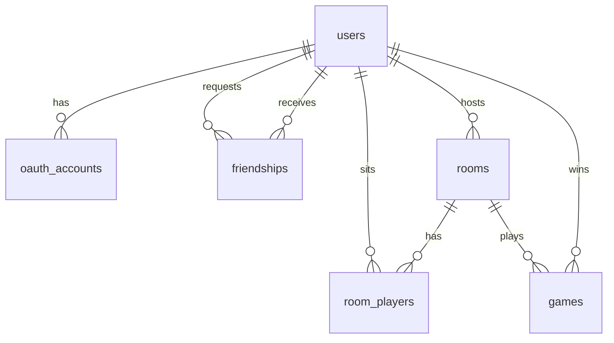

*This project has been created as part of the 42 curriculum by ivromero, aolabarr, beiglesi, <!-- TODO: Yasin's login --> ybahri.*

# Worms — ft_transcendence

## Description

<!-- TODO: 2-3 paragraphs. Goal of the project and an overview of the game. -->

**Worms** is an online 3D worm game for up to four players. One single game, configured by
parameters: depending on the settings it plays like a classic **Snake** or like a **Bomberman**.

Key features:

- 3D board rendered with Babylon.js.
- Up to 4 players per match, human or AI.
- Rooms with a lobby and a waiting room, updated in real time.
- Configurable matches: board size, speed, food, pillars, wrap-around edges, bombs.
- Accounts with email/password or Google, profiles, avatars and friends.

## Instructions

### Prerequisites

- Docker with the Compose plugin
- GNU Make
- A free port 443 (or change `HTTPS_PORT` / `HTTP_PORT` in `.env`)

### Run

```sh
cp .env.example .env                  # fill in the credentials (make up creates it if missing)
cp backend/.env.example backend/.env  # APP_KEY lives here, never in the root .env
make up                               # development mode, with hot reload
# or
make prod                             # static build served by nginx
```

Open <https://localhost>. The certificate is self-signed, so the browser shows a warning the
first time. `https://localhost/api/health` reports the state of the database and Redis.

<!-- TODO: explain each block of .env (database, Redis, Reverb, Google OAuth, ports) and how to
generate APP_KEY. -->

Other commands: `make down`, `make logs`, `make migrate`, `make test`, `make fclean`.

## Team Information

<!-- TODO: role(s) and a short description of the responsibilities of each member. -->

| Member | Login | Role(s) | Responsibilities |
|---|---|---|---|
| Iván Romero | ivromero | | |
| Aritz Olabarriaga | aolabarr | | |
| Betsabé Iglesias | beiglesi | | |
| Yasin Bahri | ybahri | | |

## Project Management

<!-- TODO: how the work was split, meetings, tools (GitHub Issues/Projects, PRs with review...),
communication channels (Discord, Slack...). -->

## Technical Stack

<!-- TODO: justify each choice in one or two lines. -->

| Part | Technology |
|---|---|
| Frontend | React 19, TypeScript, Vite 8, Tailwind CSS 4, react-router |
| 3D | Babylon.js |
| Backend | Laravel 13 (PHP 8.4, php-fpm) |
| Real time | Laravel Reverb (WebSockets) + Laravel Echo |
| Authentication | Laravel Sanctum (cookie sessions), Laravel Socialite (Google) |
| Database | MariaDB 11.4 |
| Live game state, cache, queues | Redis 7 |
| Reverse proxy and TLS | nginx 1.27 |
| Deployment | Docker Compose, one command (`make up`) |

## Database Schema

<!-- TODO: check against the final migrations. -->



| Table | Key fields | Relations |
|---|---|---|
| `users` | `username` (unique), `email` (unique), `password` (nullable for OAuth), `avatar`, `bio` | — |
| `oauth_accounts` | `provider`, `provider_id`, `access_token`, `refresh_token` | `user_id` → `users` |
| `friendships` | `status` (`pending`, `accepted`) | `requester_id`, `addressee_id` → `users` |
| `rooms` | `code` (unique), `name`, `status` (`open`, `playing`), `settings` (JSON) | `host_id` → `users` |
| `room_players` | `seat`; a null `user_id` is a bot | `room_id` → `rooms`, `user_id` → `users` |
| `games` | `started_at`, `ended_at` | `room_id` → `rooms`, `winner_user_id` → `users` |

The state of a running match does not touch the database: it lives in Redis while the game is
being played.

## Features List

<!-- TODO: complete list, who worked on each feature and a short description. -->

| Feature | Team member(s) | Description |
|---|---|---|
| Sign up and log in | Betsabé, Iván, Aritz | |
| Google login | Betsabé, Iván | |
| Profile, avatar and friends | Aritz | |
| Lobby and rooms | Betsabé, Aritz, Iván | |
| Waiting room | Betsabé, Iván | |
| Game (rules, server loop, bots, 3D) | Iván, Yasin | |
| Health / status page | Iván, Betsabé, Yasin | |
| Privacy Policy and Terms of Service | Yasin, Iván, Betsabé, Aritz | |

## Modules

| # | Module | Type | Points | Team member(s) |
|---|---|---|---|---|
| 1 | Use a framework for both the frontend and the backend | Major | 2 | Iván, Betsabé, Aritz |
| 2 | Real-time features using WebSockets | Major | 2 | Iván, Betsabé |
| 3 | Use an ORM for the database | Minor | 1 | Aritz, Betsabé |
| 4 | Standard user management and authentication | Major | 2 | Aritz |
| 5 | Remote authentication with OAuth 2.0 | Minor | 1 | Betsabé, Iván |
| 6 | Complete web-based game | Major | 2 | Iván, Yasin |
| 7 | Remote players | Major | 2 | Iván |
| 8 | Multiplayer game (more than two players) | Major | 2 | Iván |
| 9 | AI opponent | Major | 2 | Iván |
| 10 | Advanced 3D graphics (Babylon.js) | Major | 2 | Iván, Yasin |
| 11 | Game customization options | Minor | 1 | Betsabé, Aritz, Iván |
| 12 | Custom design system with reusable components | Minor | 1 | Betsabé, Iván, Yasin |
| 13 | Spectator mode | Minor | 1 | |
| 14 | Health check and status page, with automated backups and disaster recovery | Minor | 1 | Iván |
| | **Total** | | **22** | |

**Points:** 8 majors × 2 + 6 minors × 1 = **22 points**, of which 14 are mandatory. We claim more
than 14 on purpose, as the subject suggests, in case a module is not validated.

<!-- Do not claim a module that does not work: if one of the TODOs below is not closed before the
evaluation, remove the module from the table and fix the total. -->

### 1. Framework for frontend and backend — Major (2)

**Why:** React and Laravel are mature, well documented, and each covers exactly one side of the
application. React keeps the interface in components; Laravel gives authentication, validation,
queues and broadcasting out of the box.

**How:** the frontend is a React 19 + TypeScript single-page app built with Vite
(`frontend/`). The backend is a Laravel 13 API (`backend/`). Both sit behind the same nginx, which
serves the app on `/` and sends `/api` to Laravel, so the browser only ever talks to one origin.

### 2. Real-time features using WebSockets — Major (2)

**Why:** the lobby, the waiting room and the game itself must update for every player at the
same moment, without reloading the page.

**How:** Laravel Reverb is the WebSocket server, and the browser listens with Laravel Echo
(`frontend/src/lib/echo.ts`). All channels are private and authorized in
`backend/routes/channels.php`:

| Channel | Who can join | Events |
|---|---|---|
| `lobby` | any logged-in user | `room.updated` — a room is created, fills up or starts |
| `room.{code}` | members of the room | `players.updated`, `match.started` |
| `game.{id}` | players of the match | `tick` — the full game state, about 10 times per second |

- **Broadcast:** one message per tick per match, sent once and received by every player.
- **Connections:** each page leaves its channel when it closes, and the status page shows the
  live connection state.

### 3. ORM — Minor (1)

**Why:** Eloquent ships with Laravel and lets us express the data model as relations instead of
SQL.

**How:** models in `backend/app/Models`: `User`, `OauthAccount`, `Friendship`, `Room`,
`RoomPlayer` and `Game`, linked with `hasMany` / `belongsTo` relations. The tables are created
by migrations.

### 4. Standard user management and authentication — Major (2)

**Why:** players need an identity to find friends, join rooms and keep their results.

**How:**

- **Profile update:** `PATCH /api/user` changes username, name, email, bio and password, with
  validation in the frontend and the backend.
- **Avatar:** `POST /api/user/avatar` accepts PNG/JPG up to 2 MB, crops it to 256×256 and stores
  it. Users without an upload get a default avatar.
- **Friends:** send, accept and remove requests, and search users (`/api/friends`,
  `/api/users/search`).
- **Profile page:** `/profile/:userId` shows the user's information.

<!-- TODO before evaluation: friends' online status is always "offline"
(frontend/src/components/friends/api.ts). The subject requires showing it. -->

### 5. Remote authentication with OAuth 2.0 — Minor (1)

**Why:** logging in with Google is faster than creating another password.

**How:**

- `/auth/google/redirect` and `/auth/google/callback` (Laravel Socialite) carry out the OAuth 2.0
  authorization code flow.
- Google accounts are stored in `oauth_accounts` and linked to the user.
- An unverified Google email is rejected, and the session is rotated after login.
- Covered by `backend/tests/Feature/GoogleAuthTest.php`.

### 6. Complete web-based game — Major (2)

**Why:** the game is the center of the project.

**How:**

- **Rules:** each worm moves one cell per tick, eating food makes it grow, and hitting a wall or
  a body kills or blocks it, depending on the settings. A head-on collision kills both worms.
- **End of the match:** it ends when one worm or none is left alive; the last worm alive wins.
- **Where the rules live:** in the server (`backend/app/Game/`), with a TypeScript copy for the
  offline demo (`frontend/src/game/logic/`).
- **Start:** a match opens with a 3-second countdown, and a scoreboard shows the live result.

<!-- TODO before evaluation: the winner is only computed in the browser; save it in
games.winner_user_id when the match ends. -->

### 7. Remote players — Major (2)

**Why:** each player plays from their own computer.

**How:**

- **Server-authoritative loop:** the `gameloop` service (`php artisan game:tick`) advances every
  running match, keeps its state in Redis, and broadcasts each tick. Players only send their key
  presses (`POST /api/games/{id}/turn`), so the clients can never disagree.
- **Latency:** the browser interpolates between the previous and the current tick, so movement
  looks smooth at 60 fps even though the server sends about 10 updates per second.
- **Disconnection and reconnection:** the page pings the server every second.
  - After 2.5 s without a signal, the worm stops and turns grey.
  - If the player comes back within the next 10 s, they continue where they left off.
  - Otherwise the worm is eliminated.

### 8. Multiplayer game (more than two players) — Major (2)

**Why:** a four-player match is far more chaotic and fun than a duel.

**How:**

- Rooms accept 1 to 4 seats, validated in the frontend and the backend.
- Seats are assigned inside a database transaction, so two players can never take the same one.
- All the worms move in the same tick and collisions are resolved for all of them at once, so no
  player gets an advantage from the order of the moves.
- Every client draws the same state, received on the same channel.

### 9. AI opponent — Major (2)

**Why:** you can fill a room and play even when no one else is online.

**How:**

- The host adds bots from the waiting room (`POST /api/rooms/{code}/bots`).
- A bot is just another source of key presses on the server (`backend/app/Game/Bot.php`). On
  every tick it looks one cell ahead in each direction, discards walls and bodies, and moves
  towards the nearest food.
- It also goes for bombs and dodges the ones about to explode.
- It sees one cell ahead and no further, so it plays like a human and not perfectly: it can trap
  itself and it can win.
- It plays with every custom setting, because it uses the same rules as the players.

<!-- TODO before evaluation: bomb behavior depends on the bombs branch being merged. -->

### 10. Advanced 3D graphics — Major (2)

**Why:** Babylon.js includes model loading, post-processing and a scene inspector, which is all a
board game needs.

**How** (`frontend/src/game/render/`):

- **Models:** glTF models for the worm, walls, food and bombs.
- **Instancing:** repeated objects are drawn as instances.
- **Post-processing:** bloom and FXAA anti-aliasing.
- **Materials:** emissive materials and textures.
- **Smooth motion:** the worms are interpolated between server ticks.
- **Cameras:** two modes, the whole board or following your own worm.
- **Input:** keyboard and touch.

### 11. Game customization options — Minor (1)

**Why:** the same game can play like a Snake or like a Bomberman just by changing its settings.

**How:**

- When creating a room, the host chooses the number of players, board size, speed, amount of
  food, pillars and wrap-around edges.
- Default values are in `frontend/src/game/logic/settings.ts`.
- The backend validates every setting (`StoreRoomRequest`) and stores them with the room.
- **Attack:** trap bombs that worms swallow and drop from their tail.

<!-- TODO before evaluation: bombs depend on the bombs branch being merged. -->

### 12. Custom design system — Minor (1)

**Why:** one consistent look for the whole site, and less repeated code.

**How:**

- **Tokens:** colors, fonts (Bungee and Space Grotesk) and animations in
  `frontend/src/theme.css`.
- **Components:** reusable components in `frontend/src/components/ui/` (Avatar, Button, Modal,
  MessageModal, Sidebar, ToggleChip…).
- **Icons:** SVG icon sets.

<!-- TODO before evaluation: the subject requires at least 10 reusable components; there are 6 in
ui/. Move FormField, StatCard, the icons, etc. into ui/ and list all 10 here. -->

### 13. Spectator mode — Minor (1)

<!-- TODO before evaluation: not implemented. Let users who are not in the match open
game.{id} and GET /api/games/{id}, and add a "Watch" button in the lobby. If it is not done,
remove this module (−1). -->

### 14. Health check and status page — Minor (1)

**Why:** to know at a glance whether the stack is up, and to recover the data if it fails.

**How:**

- `GET /api/health` opens a real connection to MariaDB and Redis, and returns 503 if either one
  fails.
- The `/health` page shows that state, together with the live WebSocket connection.
- Docker healthchecks watch php, MariaDB and Redis.

<!-- TODO before evaluation: automated backups and a disaster recovery procedure are missing
(e.g. a scheduled mysqldump to a volume + a `make restore` command, documented here). Without
them, remove this module (−1). -->

## Individual Contributions

<!-- TODO: each member writes their own part: what they built (features, modules, components)
and the challenges they faced and how they solved them. -->

### Iván Romero (ivromero)

### Aritz Olabarriaga (aolabarr)

### Betsabé Iglesias (beiglesi)

### Yasin Bahri (ybahri)

## Resources

<!-- TODO: classic references and how AI was used (which tasks, which parts of the project). -->

- [Laravel documentation](https://laravel.com/docs)
- [Laravel Reverb](https://laravel.com/docs/reverb)
- [React documentation](https://react.dev)
- [Babylon.js documentation](https://doc.babylonjs.com)

### Use of AI
