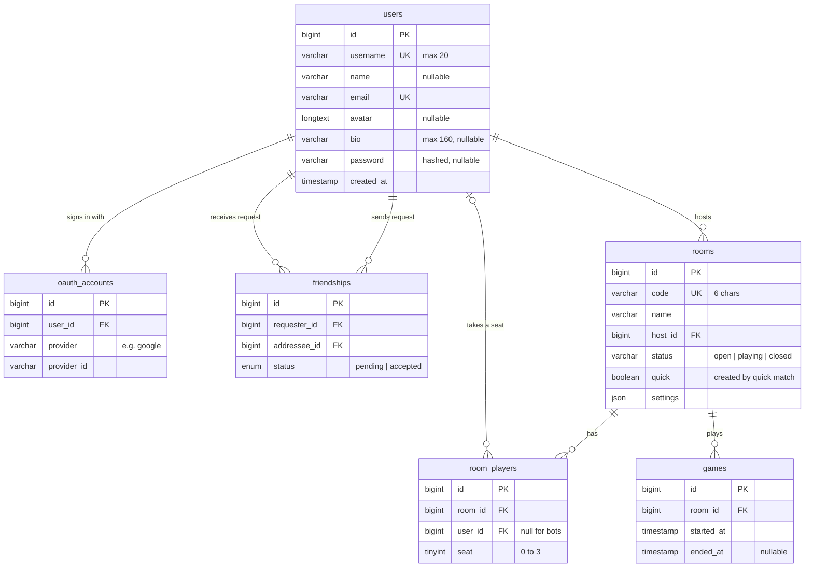

*This project has been created as part of the 42 curriculum by ivromero, aolabarr, beiglesi, ybahri.*

# Worms — ft_transcendence

## Description

**Worms** is an online multiplayer worm game for up to four players, rendered in 3D in
the browser. There is only one game, but every match is defined by a set of rules, and those rules change its nature completely: an open board with food and deadly walls plays like a classic **Snake**; add pillars, random walls and bombs and it turns into a
**Bomberman**-style arena where worms swallow bombs and drop them from their tail to
blow up walls and trap their rivals.


## Game Rules

### Goal
Be the last worm standing. Eat to grow, use bombs to cut down your rivals and avoid
crashing.

### Setting up a match
The host picks a **preset** or tunes every setting by hand:

| Preset | Board | Food | Bombs | Obstacles | Hitting a wall / a body |
|---|---|---|---|---|---|
| **Classic** | Medium | 1 | — | — | Kills / Kills |
| **Arena** | Medium | 3 | 2 | Random walls | Kills / Blocks |
| **Maze** | Medium | 5 | 4 | Pillars | Blocks / Blocks |
| **Hardcore** | Medium | 15 | 10 | Random walls | Kills / Kills |

Custom settings: number of players (1–4), board size (small, medium, large), speed,
food, bombs, starting length, pillars, random walls, what happens when hitting a wall
or a body, how often bots make mistakes, and the camera (whole board, following your
worm or behind its head). Empty seats can be filled with bots.

### Controls
- **Keyboard:** `←` / `→` or `A` / `D` turn the worm left or right.
- **Touch:** tap the left or right half of the screen to turn, or swipe to head that way.

A worm can never turn back on itself.

### Playing
- The match starts after a 3-second countdown, with each worm in a corner of the board.
- The game advances in ticks: every tick, all worms move one cell forward at the same time.
A tick lasts between 100 ms and 300 ms, depending on the speed chosen for the match.
- **Food:** eating it makes the worm one cell longer. A new piece appears somewhere else.

### Collisions
- **Walls and bodies:** depending on the settings, hitting a wall or a worm's body
  (including your own) either **kills** the worm or **blocks** it in place. A worm
  that stays blocked for 15 ticks in a row (1.5–4.5 s) dies.
- **Pillars and random walls** count as walls and follow the same setting. With
  pillars on, every wall blocks: pillars never kill.
- **Head-on:** if two worms move into the same cell, or into each other's cell, both die.

### Bombs
- Bombs lie on the board like food. A worm that swallows one **drops it at once from
  its tail**.
- After 8 ticks (0.8–2.4 s) the bomb explodes, hitting the 3×3 square around it. Walls
  and pillars are not affected.
- A blast on a worm's **head kills it**. A blast on its **body** cuts the worm at that
  point: everything from the hit segment to the tail disappears, and the worm keeps
  playing, shorter.

### End of the match
- **Two or more worms:** the match ends when one worm or none is left alive. The last
  one alive wins; if the last worms die at the same time, it is a draw.
- **Single player:** the match ends when your worm dies.
- The scoreboard ranks worms by survival first, then by how much they have grown.

### Disconnections
- If a player's page stops responding for 2.5 s, their worm stops and turns grey.
- If they come back within 10 s, they continue where they left off; otherwise the worm
  is eliminated.


### Key features

- **One game, many modes**: board size, speed, food, starting length, pillars,
  random walls, bombs, and whether hitting a wall or a body kills or just blocks.
- **Bombs**: eat one and it drops from your tail; when the fuse runs out it blasts a
  3×3 area, killing any worm head it catches and cutting any body it hits.
- **Up to 4 players** per match, mixing humans on different computers and AI bots.
- **Real-time lobby**: rooms, waiting room and match updates pushed over WebSockets.
- **Server-authoritative gameplay**: the backend runs the game loop; clients only send
  their moves.
- **3D board** rendered with Babylon.js, with three cameras: whole board, follow and
  behind the head.
- **Accounts**: email/password or Google sign-in, profiles, avatars and friends with
  online status.

## Instructions

### Prerequisites

- **Docker** with the **Compose v2** plugin (`docker compose`, not `docker-compose`).
- **GNU Make**.
- **Google Chrome**, latest stable version.
- Ports **8080** and **1443** free on the host (both configurable in `.env`).
- *Optional:* a Google Cloud OAuth client, only needed for "Sign in with Google".

Everything else (PHP, Composer, Node, MariaDB, Redis, Reverb) runs inside the containers.

### 1. Configure the environment

```bash
git clone https://github.com/imero-dev/transcendence.git
cd transcendence
cp .env.example .env
```

Edit `.env` and set at least:

| Variable | What to put |
|---|---|
| `DB_PASSWORD`, `DB_ROOT_PASSWORD` | Two passwords of your choice. |
| `REVERB_APP_KEY`, `REVERB_APP_SECRET` | Random strings (e.g. `openssl rand -hex 16`). |
| `VITE_REVERB_APP_KEY` | **The same value** as `REVERB_APP_KEY`. |
| `GOOGLE_CLIENT_ID`, `GOOGLE_CLIENT_SECRET` | Your OAuth credentials. Add `GOOGLE_REDIRECT_URI` as an authorized redirect URI in the Google console. |
| `SEED_USER*` | Two demo accounts, preset in `.env.example` so the app is usable right away. **Change the passwords in any shared deployment.** Leave any field empty to skip that account. |

`.env` is ignored by Git; never commit it.

### 2. Start the project

```bash
make
```

This single command builds the frontend, builds the images and starts the whole stack
in production mode. On first start the backend installs its dependencies, generates the
application key, runs the migrations and seeds the database, so the first launch takes
a few minutes.

### 3. Open the app

Go to **https://localhost:1443** (or the `HTTPS_PORT` you set in `.env`; `make` prints
the final URL).

The certificate is self-signed and generated on first start, so Chrome will show a
security warning: click *Advanced → Proceed to localhost*. This happens only once.

### Demo data

On first start the database is seeded with sample data:

- **18 players** with friendships between them, so search, profiles and the friends
  panel have content. They cannot log in.
- **Two demo accounts**, with the credentials set in `.env` (`SEED_USER1_*`, `SEED_USER2_*`):
  - *User 1* starts with friends and pending requests, sent and received.
  - *User 2* has a couple of friends and no link to User 1. Log in with each account
    in a different browser (or a private window) to send a request from one, accept it
    from the other and see both online.

Seeding runs on every start but never overwrites existing data, so changes made in
the app are kept. `make fresh` resets the database to this initial state.

### Useful commands

| Command | Description |
|---|---|
| `make` / `make up` | Start the stack in production mode: the frontend is built and served as static files through nginx. |
| `make dev` | Start the stack in development mode: nginx proxies to the Vite dev server, with hot reload. |
| `make down` | Stop the containers, keeping the data. |
| `make re` | Restart the stack. |
| `make logs` | Follow the logs of every service. |
| `make ps` | List the running services. |
| `make shell-php` / `make shell-front` / `make shell-db` | Open a shell in the Laravel, frontend or database container. |
| `make migrate` | Run the pending database migrations. |
| `make fresh` | Reset the database: drop all tables, migrate and seed again. |
| `make test` | Run the backend test suite. |
| `make backup` | Dump the database now, on top of the automatic dump every 6 hours. |
| `make restore FILE=backups/<date>.sql.gz` | Load a dump into the database. |
| `make fclean` | Remove containers, volumes and images. **Wipes the database and the certificate.** The dumps in `./backups` survive. |

### Backups and disaster recovery

The `backup` service dumps the MariaDB database every 6 hours into `./backups`, a
folder on the host, outside Docker, so the dumps survive `make fclean`. The newest 28
are kept (one week). Each dump is written to a temporary file and only kept if it ends
with `Dump completed`, so a dump cut in half never replaces a good one. `/health`
marks the backup as failing when the newest dump is more than 7 hours old.

To recover the database after a disaster (run `make backup` first to try it with the
current data):

1. `make fclean`: the disaster. Containers and volumes are removed, and the database
   with them.
2. `make up`: start a fresh stack.
3. `make restore FILE=backups/<date>.sql.gz`: load the last dump taken **before** the
   disaster. File names are dates. The newest file is not that one: the `backup`
   service dumps the new database (demo data only) as soon as it starts.
4. Open `/health` and check that everything is green. The users, friends and match
   history from the dump are back.

Redis is not backed up: it only holds sessions, cache, the job queue and the state of
the matches being played. After a recovery everyone has to log in again, and the
matches that were in progress are lost.

## Resources

### Documentation

**Backend**
- [Laravel](https://laravel.com/docs) — Eloquent, Broadcasting, Reverb, Sanctum, Socialite.
- [Google OAuth 2.0](https://developers.google.com/identity/protocols/oauth2)

**Frontend**
- [React](https://react.dev) and [React Router](https://reactrouter.com)
- [TypeScript](https://www.typescriptlang.org/docs/)
- [Vite](https://vite.dev)
- [Tailwind CSS](https://tailwindcss.com/docs)
- [Babylon.js](https://doc.babylonjs.com) — 3D rendering of the board.
- [Laravel Echo](https://laravel.com/docs/broadcasting#client-side-installation) — WebSocket client.

**Infrastructure**
- [Docker Compose](https://docs.docker.com/compose/)
- [nginx](https://nginx.org/en/docs/) — reverse proxy and TLS.
- [MariaDB](https://mariadb.com/kb/en/documentation/)
- [Redis](https://redis.io/docs/)

### Articles and tutorials

<!-- [RETOMAR]  -->

### Use of AI

<!-- [RETOMAR] Each member fills in their own part. -->

AI assistants ([RETOMAR: qué asistentes hemos usado?]) were used as a support tool, never as a replacement
for understanding: every piece of generated content was reviewed, tested and
discussed within the team before being merged.

| Task | Parts of the project | How it was used |
|---|---|---|
| Documentation | `README.md` | Structuring the sections from the subject requirements and reviewing the wording. |
| Learning | [RETOMAR] | Explaining concepts (e.g. Docker bind mounts and file ownership, Laravel tooling). |
| Visual design | UI look and feel, all images | Exploring the visual style of the project. All images in the project were generated with AI ChatGPT (OpenAI). |
| Rubber duck debugging | Whole project | Explaining problems and our own reasoning out loud to spot mistakes. |


AI was **not** used to generate code blindly: no code was added to the project unless
the team member could understand it, explain it and take responsibility for it.

## Team Information

| Member | Role(s) | Responsibilities |
|---|---|---|
| **aolabarr** | Project Manager, Developer | Organizes team meetings and planning, tracks progress and deadlines, keeps communication flowing and removes blockers. |
| **beiglesi** | Product Owner, Developer | Defines the product vision and the game rules, maintains and prioritizes the backlog, decides which features and modules are built, and validates finished work. |
| **ivromero** | Technical Lead, Developer | Defines the architecture and the technical stack, sets code quality standards and reviews critical changes. |
| **ybahri** | Developer | Leads the visual and creative side of the project: the look and feel of the website, its layout and the visual identity of the game. |

All members are developers: each one implements features, takes part in code reviews,
tests their own work and documents it.

## Project Management

**Work organization.** The Technical Lead first built the base architecture (Docker
stack, backend and frontend skeletons). From there, tasks were assigned as the project
evolved: each member took ownership of specific modules depending on what the project
needed at each stage.

**Meetings.** The team met weekly over video calls. Each meeting reviewed the progress
since the last one and set the goals for the following week. The team worked fully
remotely: there were no in-person meetings.

**Git workflow.** Every change was developed on its own branch (features, fixes, etc.)
and merged through a pull request. The Technical Lead reviewed every pull request
before it was merged into `main`.

**Tools.**
- **Google Meet** — weekly video meetings.
- **Google Sheets** — task tracking and weekly goals.
- **GitHub** — repository, branches and pull requests / code reviews.
- **WhatsApp** — day-to-day team communication.
## Technical Stack

### Frontend
- **React** with **TypeScript**, built with **Vite**.
- **React Router** for client-side navigation.
- **Tailwind CSS** as the styling solution.
- **Babylon.js** to render the 3D board.
- **Laravel Echo** (with `pusher-js`) as the WebSocket client.

### Backend
- **Laravel** on **PHP**, with its ORM **Eloquent**.
- **Laravel Sanctum** for cookie-based SPA authentication.
- **Laravel Socialite** for Google sign-in (OAuth 2.0).
- **Laravel Reverb** as the WebSocket server.

### Database and storage
- **MariaDB** — persistent data: users, friendships, rooms, players and matches.
- **Redis** — sessions, cache, queues and the state of live matches.

### Infrastructure
- **Docker Compose** — the whole stack starts with a single command.
- **nginx** — the only entry point: terminates HTTPS and routes requests to the frontend,
  the API and the WebSocket server.

### Justification of the main choices

**Laravel.** Chosen because of the team's previous experience with it. Its official
packages also cover most of what the project needs (authentication, OAuth, WebSockets,
queues, ORM) and integrate with each other, which kept the number of external
dependencies low.

**React + TypeScript.** Chosen because of the team's previous experience with React.
TypeScript lets the client share the same data types as the game state sent by the
server, catching mismatches at compile time.

**MariaDB.** Chosen because of the team's previous experience with it and because it is
lightweight, which suits a containerized setup. The data is strongly relational (users,
friends, rooms, players, matches), so a relational database with a strict schema and
foreign keys was the natural fit. MariaDB is open source, MySQL-compatible and fully
supported by Laravel.

**Server-authoritative game loop.** Matches run on the server: a long-running Laravel
command (`game:tick`) advances every live match at its own speed, applies the players'
inputs and the bots' moves, and broadcasts the new state to every player through Reverb.
Clients only send their moves. This keeps all players in sync, prevents cheating from
the browser and lets bots play exactly like humans.

**Redis for live matches.** A match changes state several times per second. Keeping it
in Redis avoids writing to the database on every tick; only durable data (the room,
its seats, and when each match started and ended) is stored in MariaDB.

**nginx as single entry point.** Only nginx publishes ports. Every external connection,
HTTP or WebSocket, goes through it over HTTPS, as the subject requires, while traffic
between containers stays on Docker's internal network.

## Database Schema

The database is MariaDB, managed through Laravel migrations and the Eloquent ORM.
The state of live matches is not stored here: it lives in Redis while the match is
running (see [Technical Stack](#technical-stack)).



### Tables

| Table | Purpose | Key constraints |
|---|---|---|
| `users` | Accounts and profiles. `password` is null for accounts created with Google; `avatar` stores either the path of a gallery avatar or the uploaded image. | `username` and `email` unique. |
| `oauth_accounts` | Links a user to an external provider (Google). Only the provider's user id is stored, no tokens. | One account per provider and user; one user per provider id. |
| `friendships` | Friend requests and accepted friendships between two users. | One row per pair (requester, addressee). |
| `rooms` | Match rooms: name, invitation code, host, status and the match settings (board, speed, bombs…) as JSON. `quick` marks rooms created by quick match, which are hidden from the lobby list. | `code` unique. |
| `room_players` | Seats in a room. A seat holds either a human (`user_id`) or a bot (`user_id` null). | One user per room; one player per seat. |
| `games` | Each match played in a room, with its start and end time. | — |

All foreign keys cascade on delete.

Laravel also creates its own framework tables (`sessions`, `cache`, `jobs`,
`personal_access_tokens`, `migrations`…), not shown above.

## Features List

<!-- [RETOMAR] Completar una vez esté acabado el código. -->

| Feature | Description | Member(s) |
|---|---|---|
| **Infrastructure** | | |
| Docker stack | Whole stack started with one command; nginx as the single HTTPS entry point. | ivromero |
| **Accounts and authentication** | | |
| Sign up and log in | Email and password authentication with hashed passwords, rate limited. | ivromero, beiglesi |
| Google sign-in | Log in or create an account with Google (OAuth 2.0). | beiglesi |
| **Profiles and social** | | |
| User profile | Username, bio and avatar, chosen from a gallery or uploaded; default avatar if none is set. | aolabarr |
| Friends | Send, accept and remove friend requests, updated live; friends' online status. | aolabarr, ybahri |
| **Navigation and UI** | | |
| Landing page | Public landing page, responsive. | beiglesi, ybahri |
| App layout | Dashboard layout, left sidebar with navigation and route guard, right sidebar with friends. | ybahri, beiglesi, aolabarr |
| Design system | Reusable components, colour palette and typography. | ybahri |
| Responsive design | Layout adapted to mobile and desktop. | ybahri |
| Privacy Policy and Terms of Service | Legal pages accessible from the application. | ybahri |
| **Rooms and lobby** | | |
| Lobby | List of open rooms, updated in real time, with search by name. | beiglesi, ybahri |
| Waiting room | Players and bots in the room, updated in real time; the host starts the match. | beiglesi, aolabarr |
| **Game** | | |
| 3D game | Board rendered with Babylon.js, with three cameras: whole board, follow and behind the head. | ivromero |
| Server game loop | The server runs every match and broadcasts each tick. | ivromero |
| Multiplayer | Up to 4 players on different computers. | ivromero |
| Bots | AI players that skip looking ahead on a share of ticks chosen by the host (20–80 %), so they can be beaten. | ivromero |
| Bombs | Eaten bombs drop from the tail and blast a 3×3 area after a fuse. | ivromero |
| Disconnections | Players who leave or lose connection are shown as away. | ivromero |
| Touch controls | On mobile, tap the left or right half of the screen to turn, or swipe to head that way. | ivromero |
| Scoreboard | In-game scoreboard and end-of-match screen. | ybahri |
| Spectator mode | Watch a match in progress. | ybahri |


## Modules

<!-- [RETOMAR]  -->

| # | Module | Type | Points | Member(s) |
|---|---|---|---|---|
| 1 | Backend framework (Laravel) | Minor | 1 | All |
| 2 | ORM (Eloquent) | Minor | 1 | All |
| 3 | Frontend framework (React) | Minor | 1 | All |
| 4 | Custom design system | Minor | 1 | ybahri |
| 5 | Support for additional browsers | Minor | 1 | [RETOMAR] |
| 6 | Standard user management | Major | 2 | aolabarr |
| 7 | Remote authentication with OAuth 2.0 | Minor | 1 | beiglesi |
| 8 | Real-time features with WebSockets | Major | 2 | ivromero, beiglesi, aolabarr |
| 9 | Health check and status page | Minor | 1 | ivromero |
| 10 | Complete web-based game | Major | 2 | ivromero |
| 11 | Advanced 3D graphics | Major | 2 | ivromero |
| 12 | Game customization options | Minor | 1 | ivromero |
| 13 | AI opponent | Major | 2 | ivromero |
| 14 | Remote players | Major | 2 | ivromero |
| 15 | Multiplayer game (more than two players) | Major | 2 | ivromero |
| 16 | Spectator mode | Minor | 1 | ybahri |
| | **Total** | | **23** | |

### 1. Backend framework — Minor
**Why:** the team already knew it, and it brings what the project needs out of the box:
session auth (Sanctum), OAuth (Socialite), WebSockets (Reverb), queues and an ORM
(Eloquent). **How:** Laravel 13 on PHP 8.4, serving a JSON API under `/api`. Routes are
grouped behind `auth:sanctum`, input is validated with Form Requests, login and
register are rate limited, state changes are broadcast as events, and the game loop
runs as an Artisan command (`game:tick`).

### 2. ORM — Minor
**Why:** it comes with Laravel and keeps database access declarative and safe from SQL
injection. **How:** Eloquent models for users, OAuth accounts, rooms, room players,
games and friendships, with their relationships and casts (room settings are stored as
JSON). The schema is versioned with migrations, with foreign keys and unique
constraints; seeders create test accounts. Joining a room runs in a transaction with
row locks. The only raw SQL is the health check's `select 1` and two `DB::raw`
column copies inside migrations.

### 3. Frontend framework — Minor
**Why:** the team already knew it, and its component model fits a UI that updates with
live data (lobby, friends, matches). **How:** React 19 with TypeScript in strict mode,
built with Vite and styled with Tailwind CSS. React Router splits the app into three
layouts (public pages, the app with sidebar, the full-screen game), guards private
routes with `RequireAuth` and lazy-loads the game page. The session lives in an
`AuthProvider` context, and a small typed API client handles Sanctum's CSRF cookie.

### 4. Custom design system — Minor
**Why:** a single visual identity across landing, lobby, profile and game, without
repeating styles in every screen. **How:** design tokens in `frontend/src/theme.css`
(Tailwind `@theme`): a dark palette (`void`, `surface`), an action color (`fuse`),
warm accents (`ember`, `gold`) and colors with a fixed meaning (`online`, `mint` for
bots); text, border and fill greys; typography with Bungee for display and Space
Grotesk for body, plus an extra small size and caps tracking; custom animations.
SVG icons as React components in `frontend/src/components/ui/icons.tsx`, all sharing
one 24×24 stroke style (some adapted from Lucide and Feather, credited in the Terms).
Eleven reusable components in `frontend/src/components/ui`:
`Button`, `Avatar`, `Modal`, `MessageModal`, `FormField`, `SearchInput`, `ToggleChip`,
`SectionHeader`, `EmptyState`, `LegalLinks` and `Sidebar`, each used in two or more places.

### 5. Support for additional browsers — Minor
**Why:** [RETOMAR]. **How:** [RETOMAR]

### 6. Standard user management — Major
**Why:** players need an identity, a profile and friends. **How:** sign up and log in
with email and password (Sanctum session cookie, rate limited, validated on both
sides). Editable profile: username, name, email, bio and password; changing email or
password asks for the current one. Avatar from a gallery or uploaded (cropped and
resized to 256×256 on the server), with a default avatar otherwise. Public profile
page. Friends: search users, send, accept, decline and remove requests, with live
online status through a Reverb presence channel.

### 7. Remote authentication — Minor
**Why:** faster sign-up for players, with no new password to remember. **How:** Google
OAuth 2.0 (authorization code flow) with Laravel Socialite, which checks the `state`
parameter against the session. Only a verified Google email is accepted: it signs into
the account with that email, or creates one with an auto-generated username. Only the
provider's user id is stored, no tokens. Errors send the user back to the landing with
a message.

### 8. Real-time features — Major
**Why:** lobby, waiting room, friends and matches must update live for every player.
**How:** Laravel Reverb as WebSocket server, behind the same nginx as the app, and
Laravel Echo on the client. Private channels are authorized by Laravel with the session
cookie: `lobby`, `room.{code}`, `game.{id}` and one per user for friend requests; a
presence channel `online` shows who is connected. Events are broadcast immediately
(`ShouldBroadcastNow`), with no queue in between. The server runs each match
(`game:tick`) and broadcasts its state on every tick; a client that drops and
reconnects is back in sync with the next tick, and the lobby and waiting room fetch
their data again on reconnect. If Reverb itself is unreachable for a moment, the loop
logs it and skips that broadcast: the state is already saved, so the next tick
carries it and no match is lost. The connection is closed and reopened
when the page goes into or comes back from the browser's back/forward cache.

### 9. Health check and status page — Minor
**Why:** to see at a glance that the whole stack is alive, and to be able to rebuild
the database after a disaster. **How:** `GET /api/health` checks the database, Redis,
the game loop, the queue and the last backup, and reports `ok` or `degraded` in the
body (always with HTTP 200, so a degraded stack never paints the browser console red);
the `/health` status page shows it every 5 seconds, plus the WebSocket connection. The
`backup` service dumps the database every 6 hours into `./backups` (outside Docker),
and `make restore FILE=…` loads a dump into a fresh stack. See
[Backups and disaster recovery](#backups-and-disaster-recovery).

### 10. Complete web-based game — Major
**Why:** the core of the project. **How:** a worm game for 1 to 4 players, played
live. The server runs every match tick by tick (`backend/app/Game`) and the browser
only draws it and sends moves. Goal, collisions, bombs and win, loss and draw
conditions are in [Game Rules](#game-rules).

### 11. Advanced 3D graphics — Major
**Why:** a 3D board makes the arena readable and alive, and lets the camera follow
your worm. **How:** Babylon.js, loaded only on the game page. glTF models for worms,
food, bombs, walls and explosions; walls, food, bombs and blasts are instances of a
single mesh each, worm segments are clones. Sky and sun lights, with the sun casting
real-time shadows (shadow map with PCF filtering); a floor that mirrors the worms in
real time (MirrorTexture); emissive materials and a post-processing pipeline (bloom,
FXAA). Worms glide smoothly between ticks by interpolating their positions every frame.
Three cameras: whole board, follow and behind the head.

### 12. Game customization — Minor
**Why:** one game that becomes many. **How:** the host starts from a preset (Classic,
Arena, Maze or Hardcore; Classic by default) and can tune players, board size, speed,
food, starting length, pillars, random walls, bombs, what a wall or body hit does, bot
mistakes and the camera. Bombs act as a power-up and an attack. The form only offers
valid values, and the backend checks them again (`StoreRoomRequest`).

### 13. AI opponent — Major
**Why:** lets a player fill a room or play without other humans. **How:** a bot is
just another source of moves, run by the server on every tick (`backend/app/Game/Bot.php`).
It looks one cell ahead, drops the moves that hit a wall, a worm or a bomb about to go
off, and heads for the nearest food or bomb, so it plays with the same settings as
everyone. It does not plan further, so it can trap itself like a person, and on a share
of ticks set by the host (bot mistakes, 20–80 %) it does not look at all.

### 14. Remote players — Major
**Why:** players must be able to play from different computers. **How:** the server
runs the match and broadcasts each tick; clients only send their moves and draw the
worms gliding between ticks, so latency doesn't make them jump. The countdown is synced
to the server clock. A page that stops pinging leaves its worm still and grey after
2.5 s; reloading the page brings the player back within 10 s, otherwise the worm is out.
A player who still has a seat and opens the lobby is asked whether to go back to the
match or leave it: nothing is decided for them, and only leaving gives up the seat.

### 15. Multiplayer (3+ players) — Major
**Why:** the game is designed for up to four players. **How:** up to four seats per
room, humans and bots mixed. Every worm starts in its own corner, at the same distance
from the walls, and all of them move at the same time on each tick: head-on crashes
are worked out first, and every collision is checked against the board as it was
before anyone moved, so the seat order never matters. All clients draw the same
server state.

### 16. Spectator mode — Minor
**Why:** friends can watch a match in progress without taking a seat. **How:** the
lobby lists rooms that are playing with a "Spectate" button. A spectator opens the same
game page with no seat: the server sends the same ticks over the game channel, the
camera shows the whole board, there are no controls or pings, and the server refuses
moves from anyone without a seat. At the end it shows who won and goes back to the
lobby.


## Individual Contributions

<!-- [RETOMAR] Challenges de cada uno. -->

### ivromero — Technical Lead, Developer

- **Architecture and infrastructure:** Docker stack, nginx with HTTPS, base structure of
  the backend and the frontend.
- **Authentication:** sign-up and login API with Sanctum sessions and rate limiting.
- **Game engine:** game models, the server game loop (`game:tick`), multiplayer
  synchronization and the bomb mechanics.
- **3D game:** rendering of the board with Babylon.js.
- **AI opponent:** the bot and its tests.
- **Remote play:** player presence, disconnection and reconnection.
- **Touch controls** for mobile devices.
- **Code quality:** refactors (error handling middleware) and review of the team's
  pull requests.

**Challenges:** [RETOMAR]

### aolabarr — Project Manager, Developer

- **Profiles:** profile page, edit profile modal and its API (username, bio, avatar
  stored in the database).
- **Friends:** right sidebar with the friends panel, live friend requests and online
  status with Reverb presence channels.
- **Waiting room:** first version of the waiting room in the frontend.
- **Game:** player identity in rooms and matches.
- **Data:** seeders with sample players, friendships and demo accounts.
- **Validation and fixes:** form validation in frontend and backend, Makefile fixes.
- **Project management:** weekly meetings, planning and progress tracking.

**Challenges:** I had no previous experience in web development, so most of the work
meant learning while building. The friends system was the most complete example: it
covered the whole stack, from the migration and model to the API, the React panel and
real-time updates with Reverb. As Project Manager, I prepared the agenda for each
meeting so that they stayed focused and useful.

### beiglesi — Product Owner, Developer

- **Authentication:** login frontend and Google sign-in. [RETOMAR: confirm scope.]
- **Rooms:** real rooms with a live lobby and waiting room, connected to the backend.
- **Navigation:** left sidebar, navigation, route guard and route refactor.
- **Landing page:** restyle with the curved worm, sprites and shared theme.
- **Game integration:** "Play now" moved to React and wired to the game.
- **Fixes:** tokens and replacement of repeated images.
- **Product ownership:** game rules, backlog and priorities, validation of finished
  work, and the README.

**Challenges:** [RETOMAR]

### ybahri — Developer

- **Visual identity:** look and feel of the website and the game.
- **Design system:** 11 reusable components with a shared palette and typography.
- **Layout:** dashboard layout, first versions of the lobby and the social panel.
- **Responsive design:** landing page and app adapted to mobile and desktop.
- **Lobby:** search rooms by name.
- **Game UI:** in-game scoreboard and end-of-match screen.
- **Spectator mode:** watch a match in progress from the lobby.
- **Legal pages:** Privacy Policy and Terms of Service.

**Challenges:** Before this project, my only experience was the 42 common core: mostly
backend work in C and C++. Frontend, React and Laravel were all new to me, and the
biggest challenge was changing the way I think, from programs that run step by step to
screens that update themselves when something changes. Spectator mode was the first
feature I built on both sides, from the lobby to the server. I also learned to build on
code that my teammates were changing at the same time.


