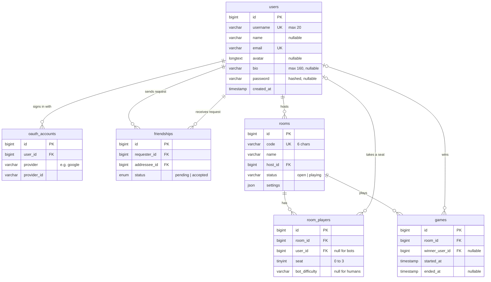

*This project has been created as part of the 42 curriculum by ivromero, aolabarr, beiglesi, ybahri.*

# Worms — ft_transcendence

## Description

**Worms** is an online multiplayer worm game for up to four players, rendered in 3D in
the browser. There is only one game, but every match is defined by a set of rules, and those rules change its nature completely: an open board with food and deadly walls plays like a classic **Snake**; add pillars, breakable walls and bombs and it turns into a
**Bomberman**-style arena where worms swallow bombs and drop them from their tail to
blow up walls and trap their rivals.


### Key features

- **One game, many modes**: board size, speed, food, starting length, pillars,
  breakable walls, bombs, and whether hitting a wall or a body kills or just blocks.
- **Bombs**: eat one and it drops from your tail; when the fuse runs out it blasts a
  3×3 area, breaking walls and killing any worm head it catches.
- **Up to 4 players** per match, mixing humans on different computers and AI bots.
- **Real-time lobby**: rooms, waiting room and match updates pushed over WebSockets.
- **Server-authoritative gameplay**: the backend runs the game loop; clients only send
  their moves.
- **3D board** rendered with Babylon.js, with a fixed or a follow camera.
- **Accounts**: email/password or Google sign-in, profiles, avatars and friends with
  online status.

## Instructions

### Prerequisites

- **Docker** with the **Compose v2** plugin (`docker compose`, not `docker-compose`).
- **GNU Make**.
- **Google Chrome**, latest stable version.
- Ports **8080** and **1443** free on the host (both configurable in `.env`).
- *Optional:* a Google Cloud OAuth client, only needed for "Sign in with Google".

Everything else (PHP, Composer, Node, MariaDB, Redis, Reverb) runs inside the containers.

### 1. Configure the environment

```bash
git clone https://github.com/imero-dev/transcendence.git
cd transcendence
cp .env.example .env
```

Edit `.env` and set at least:

| Variable | What to put |
|---|---|
| `UID`, `GID` | Your host user, from `id -u` and `id -g`. Keeps generated files owned by you. |
| `DB_PASSWORD`, `DB_ROOT_PASSWORD` | Two passwords of your choice. |
| `REVERB_APP_KEY`, `REVERB_APP_SECRET` | Random strings (e.g. `openssl rand -hex 16`). |
| `VITE_REVERB_APP_KEY` | **The same value** as `REVERB_APP_KEY`. |
| `GOOGLE_CLIENT_ID`, `GOOGLE_CLIENT_SECRET` | Your OAuth credentials. Add `GOOGLE_REDIRECT_URI` as an authorized redirect URI in the Google console. |
| `SEED_USER*` | *Optional.* Demo accounts created on first start; an account with any empty field is skipped. |

`.env` is ignored by Git; never commit it.

### 2. Start the project

> **[RETOMAR]** una vez definido make definitivo.

```bash
make
```

This single command builds the images and starts the whole stack. On first start the
backend installs its dependencies, generates the application key, runs the migrations
and seeds the database, so the first launch takes a few minutes.

### 3. Open the app

Go to **https://localhost:[RETOMAR]**.

> **[RETOMAR]** The HTTPS port is not settled yet: `HTTPS_PORT` in `.env.example` is
> `1443`, but the `Makefile` prints `https://localhost` and `APP_URL` has no port.
> Once decided, update this URL, `APP_URL`, `GOOGLE_REDIRECT_URI` and the message
> printed by `make up` so they all match.
The certificate is self-signed and generated on first start, so Chrome will show a
security warning: click *Advanced → Proceed to localhost*. This happens only once.

### Useful commands

> **[RETOMAR]** y revisar los phony

| Command | Description |
|---|---|
| `make` / `make up` | Start the stack (development mode, with hot reload). |
| `make prod` | Build the frontend and serve it as static files through nginx. |
| `make down` | Stop the containers, keeping the data. |
| `make re` | Restart the stack. |
| `make logs` | Follow the logs of every service. |
| `make test` | Run the backend test suite. |
| `make fresh` | Reset the database: drop all tables, migrate and seed again. |
| `make fclean` | Remove containers, volumes and images. **Wipes the database and the certificate.** |

## Resources

### Documentation

**Backend**
- [Laravel](https://laravel.com/docs) — Eloquent, Broadcasting, Reverb, Sanctum, Socialite.
- [Google OAuth 2.0](https://developers.google.com/identity/protocols/oauth2)

**Frontend**
- [React](https://react.dev) and [React Router](https://reactrouter.com)
- [TypeScript](https://www.typescriptlang.org/docs/)
- [Vite](https://vite.dev)
- [Tailwind CSS](https://tailwindcss.com/docs)
- [Babylon.js](https://doc.babylonjs.com) — 3D rendering of the board.
- [Laravel Echo](https://laravel.com/docs/broadcasting#client-side-installation) — WebSocket client.

**Infrastructure**
- [Docker Compose](https://docs.docker.com/compose/)
- [nginx](https://nginx.org/en/docs/) — reverse proxy and TLS.
- [MariaDB](https://mariadb.com/kb/en/documentation/)
- [Redis](https://redis.io/docs/)

### Articles and tutorials

<!-- [RETOMAR]  -->

### Use of AI

<!-- [RETOMAR] Each member fills in their own part. -->

AI assistants ([RETOMAR: qué asistentes hemos usado?]) were used as a support tool, never as a replacement
for understanding: every piece of generated content was reviewed, tested and
discussed within the team before being merged.

| Task | Parts of the project | How it was used |
|---|---|---|
| Documentation | `README.md` | Structuring the sections from the subject requirements and reviewing the wording. |
| Learning | [RETOMAR] | Explaining concepts (e.g. Docker bind mounts and file ownership, Laravel tooling). |
| Visual design | UI look and feel, all images | Exploring the visual style of the project. All images in the project were generated with AI ChatGPT (OpenAI). |
| Rubber duck debugging | Whole project | Explaining problems and our own reasoning out loud to spot mistakes. |


AI was **not** used to generate code blindly: no code was added to the project unless
the team member could understand it, explain it and take responsibility for it.

## Team Information

| Member | Role(s) | Responsibilities |
|---|---|---|
| **aolabarr** | Project Manager, Developer | Organizes team meetings and planning, tracks progress and deadlines, keeps communication flowing and removes blockers. |
| **beiglesi** | Product Owner, Developer | Defines the product vision and the game rules, maintains and prioritizes the backlog, decides which features and modules are built, and validates finished work. |
| **ivromer** | Technical Lead, Developer | Defines the architecture and the technical stack, sets code quality standards and reviews critical changes. |
| **ybahri** | Developer | Leads the visual and creative side of the project: the look and feel of the website, its layout and the visual identity of the game. |

All members are developers: each one implements features, takes part in code reviews,
tests their own work and documents it.

## Project Management

**Work organization.** The Technical Lead first built the base architecture (Docker
stack, backend and frontend skeletons). From there, tasks were assigned as the project
evolved: each member took ownership of specific modules depending on what the project
needed at each stage.

**Meetings.** The team met weekly over video calls. Each meeting reviewed the progress
since the last one and set the goals for the following week. The team worked fully
remotely: there were no in-person meetings.

**Git workflow.** Every change was developed on its own branch (features, fixes, etc.)
and merged through a pull request. The Technical Lead reviewed every pull request
before it was merged into `main`.

**Tools.**
- **Google Meet** — weekly video meetings.
- **Google Sheets** — task tracking and weekly goals.
- **GitHub** — repository, branches and pull requests / code reviews.
- **WhatsApp** — day-to-day team communication.
## Technical Stack

### Frontend
- **React** with **TypeScript**, built with **Vite**.
- **React Router** for client-side navigation.
- **Tailwind CSS** as the styling solution.
- **Babylon.js** to render the 3D board.
- **Laravel Echo** (with `pusher-js`) as the WebSocket client.

### Backend
- **Laravel** on **PHP**, with its ORM **Eloquent**.
- **Laravel Sanctum** for cookie-based SPA authentication.
- **Laravel Socialite** for Google sign-in (OAuth 2.0).
- **Laravel Reverb** as the WebSocket server.

### Database and storage
- **MariaDB** — persistent data: users, friendships, rooms, players and matches.
- **Redis** — sessions, cache, queues and the state of live matches.

### Infrastructure
- **Docker Compose** — the whole stack starts with a single command.
- **nginx** — the only entry point: terminates HTTPS and routes requests to the frontend,
  the API and the WebSocket server.

### Justification of the main choices

**Laravel.** Chosen because of the team's previous experience with it. Its official
packages also cover most of what the project needs (authentication, OAuth, WebSockets,
queues, ORM) and integrate with each other, which kept the number of external
dependencies low.

**React + TypeScript.** Chosen because of the team's previous experience with React.
TypeScript lets the client share the same data types as the game state sent by the
server, catching mismatches at compile time.

**MariaDB.** Chosen because of the team's previous experience with it and because it is
lightweight, which suits a containerized setup. The data is strongly relational (users,
friends, rooms, players, matches), so a relational database with a strict schema and
foreign keys was the natural fit. MariaDB is open source, MySQL-compatible and fully
supported by Laravel.

**Server-authoritative game loop.** Matches run on the server: a long-running Laravel
command (`game:tick`) advances every live match at its own speed, applies the players'
inputs and the bots' moves, and broadcasts the new state to every player through Reverb.
Clients only send their moves. This keeps all players in sync, prevents cheating from
the browser and lets bots play exactly like humans.

**Redis for live matches.** A match changes state several times per second. Keeping it
in Redis avoids writing to the database on every tick; only durable data (who played,
when it ended) is stored in MariaDB.

**nginx as single entry point.** Only nginx publishes ports. Every external connection,
HTTP or WebSocket, goes through it over HTTPS, as the subject requires, while traffic
between containers stays on Docker's internal network.

## Database Schema [RETOMAR]

The database is MariaDB, managed through Laravel migrations and the Eloquent ORM.
The state of live matches is not stored here: it lives in Redis while the match is
running (see [Technical Stack](#technical-stack)).



### Tables

| Table | Purpose | Key constraints |
|---|---|---|
| `users` | Accounts and profiles. `password` is null for accounts created with Google; `avatar` stores either the path of a gallery avatar or the uploaded image. | `username` and `email` unique. |
| `oauth_accounts` | Links a user to an external provider (Google). Only the provider's user id is stored, no tokens. | One account per provider and user; one user per provider id. |
| `friendships` | Friend requests and accepted friendships between two users. | One row per pair (requester, addressee). |
| `rooms` | Match rooms: name, invitation code, host and the match settings (board, speed, bombs…) as JSON. | `code` unique. |
| `room_players` | Seats in a room. A seat holds either a human (`user_id`) or a bot (`bot_difficulty`). | One user per room; one player per seat. |
| `games` | Each match played in a room, with its start and end time. | — |

All foreign keys cascade on delete, except `games.winner_user_id`, which is set to null
if the user is deleted.

Laravel also creates its own framework tables (`sessions`, `cache`, `jobs`,
`personal_access_tokens`, `migrations`…), not shown above.

## Features List

<!-- [RETOMAR] Completar una vez esté acabado el código. -->

| Feature | Description | Member(s) |
|---|---|---|
| **Infrastructure** | | |
| Docker stack | Whole stack started with one command; nginx as the single HTTPS entry point. | ivromer |
| **Accounts and authentication** | | |
| Sign up and log in | Email and password authentication with hashed passwords and email verification. |  beiglesi |
| Google sign-in | Log in or create an account with Google (OAuth 2.0). | beiglesi |
| **Profiles and social** | | |
| User profile | Username, bio and avatar, chosen from a gallery or uploaded; default avatar if none is set. | aolabarr |
| Friends | Send, accept and remove friend requests, updated live; friends' online status. | aolabarr, ybahri |
| **Navigation and UI** | | |
| Landing page | Public landing page, responsive. | beiglesi, ybahri |
| App layout | Dashboard layout, left sidebar with navigation and route guard, right sidebar with friends. | ybahri, beiglesi, aolabarr |
| Design system | Reusable components, colour palette and typography. | ybahri |
| Responsive design | Layout adapted to mobile and desktop. | ybahri |
| Privacy Policy and Terms of Service | Legal pages accessible from the application. | ybahri |
| **Rooms and lobby** | | |
| Lobby | List of open rooms, updated in real time, with search by name or code. | beiglesi, ybahri |
| Waiting room | Players and bots in the room, updated in real time; the host starts the match. | beiglesi, aolabarr |
| **Game** | | |
| 3D game | Board rendered with Babylon.js, with a fixed or a follow camera. | ivromer |
| Server game loop | The server runs every match and broadcasts each tick. | ivromer |
| Multiplayer | Up to 4 players on different computers. | ivromer |
| Bots | AI players with different difficulty levels. | ivromer |
| Bombs | Eaten bombs drop from the tail and blast a 3×3 area after a fuse. | ivromer |
| Disconnections | Players who leave or lose connection are shown as away. | ivromer |
| Touch controls | On-screen controls for mobile devices. | ivromer |
| Scoreboard | In-game scoreboard and end-of-match screen. | ybahri |
| Spectator mode | Watch a match in progress. | ybahri |
| **[RETOMAR]** | | |
| Tournaments | [RETOMAR] | [RETOMAR] |

## Modules

<!-- [RETOMAR]  -->

| Module | Type | Points | Member(s) |
|---|---|---|---|
| Frontend framework (React) | Minor | 1 | All |
| Backend framework (Laravel) | Minor | 1 | All |
| ORM (Eloquent) | Minor | 1 | All |
| Real-time features with WebSockets | Major | 2 | ivromer, beiglesi, aolabarr |
| Standard user management | Major | 2 | aolabarr |
| Remote authentication with OAuth 2.0 | Minor | 1 | beiglesi |
| Complete web-based game | Major | 2 | ivromer |
| Remote players | Major | 2 | ivromer |
| Multiplayer game (more than two players) | Major | 2 | ivromer |
| AI opponent | Major | 2 | ivromer |
| Game customization options | Minor | 1 | ivromer |
| Tournament system | Minor | 1 | [RETOMAR] |
| Spectator mode | Minor | 1 | ybahri |
| Custom design system | Minor | 1 | ybahri |
| **Total** | | **[RETOMAR]** | |

### Frontend and backend frameworks — Minor + Minor
**Why:** previous experience of the team with both. **How:** React with TypeScript and
Vite on the frontend; Laravel on the backend, exposing a JSON API under `/api`.

### ORM — Minor
**Why:** comes with Laravel and keeps database access declarative and safe. **How:**
every table has an Eloquent model with its relationships; the schema is versioned with
migrations.

### Real-time features — Major
**Why:** lobby, waiting room, friends and matches must update live for every player.
**How:** Laravel Reverb as WebSocket server and Laravel Echo on the client, with private
channels authorized by Laravel; matches broadcast their state on every tick.

### Standard user management — Major
**Why:** players need an identity, a profile and friends. **How:** editable profile,
avatar from a gallery or uploaded (default avatar otherwise), profile page, friends
with live online status.

### Remote authentication — Minor
**Why:** faster sign-up for players. **How:** Google OAuth 2.0 with Laravel Socialite;
only the provider's user id is stored.

### Complete web-based game — Major
**Why:** the core of the project. **How:** see [Description](#description) and
[Game Rules](#game-rules).

### Remote players — Major
**Why:** players must be able to play from different computers. **How:** the server runs
the match and broadcasts each tick; clients only send their moves. Players who lose
connection are marked as away. [RETOMAR: reconnection.]

### Multiplayer (3+ players) — Major
**Why:** the game is designed for up to four players. **How:** up to four seats per
room, all synchronized from the same server state.

### AI opponent — Major
**Why:** lets a player fill a room or play without other humans. **How:** [RETOMAR:
how the bot decides its moves, difficulty levels, how it avoids perfect play.]

### Game customization — Minor
**Why:** one game that becomes many. **How:** board size, speed, food, starting
length, pillars, breakable walls, bombs and collision rules; Snake-like defaults.

### Tournament system — Minor
[RETOMAR]

### Spectator mode — Minor
**Why:** [RETOMAR]. **How:** [RETOMAR]

### Custom design system — Minor
**Why:** [RETOMAR]. **How:** [RETOMAR: palette, typography, icons, list of the 10+
components.]


## Individual Contributions

<!-- [RETOMAR] Challenges de cada uno. -->

### ivromer — Technical Lead, Developer

- **Architecture and infrastructure:** Docker stack, nginx with HTTPS, base structure of
  the backend and the frontend.
- **Authentication:** login and email verification.
- **Game engine:** game models, the server game loop (`game:tick`), multiplayer
  synchronization and the bomb mechanics.
- **3D game:** rendering of the board with Babylon.js.
- **AI opponent:** the bot and its tests.
- **Remote play:** player presence, disconnection and reconnection.
- **Touch controls** for mobile devices.
- **Code quality:** refactors (error handling middleware) and review of the team's
  pull requests.

**Challenges:** [RETOMAR]

### aolabarr — Project Manager, Developer

- **Profiles:** profile page, edit profile modal and its API (username, bio, avatar
  stored in the database).
- **Friends:** right sidebar with the friends panel, live friend requests and online
  status with Reverb presence channels.
- **Waiting room:** first version of the waiting room in the frontend.
- **Game:** player identity in rooms and matches.
- **Data:** production seeder with players and friendships.
- **Validation and fixes:** form validation in frontend and backend, Makefile fixes.
- **Project management:** weekly meetings, planning and progress tracking.

**Challenges:** [RETOMAR]

### beiglesi — Product Owner, Developer

- **Authentication:** login frontend and Google sign-in. [RETOMAR: confirm scope.]
- **Rooms:** real rooms with a live lobby and waiting room, connected to the backend.
- **Navigation:** left sidebar, navigation, route guard and route refactor.
- **Landing page:** restyle with the curved worm, sprites and shared theme.
- **Game integration:** "Play now" moved to React and wired to the game.
- **Fixes:** tokens and replacement of repeated images.
- **Product ownership:** game rules, backlog and priorities, validation of finished
  work, and the README.

**Challenges:** [RETOMAR]

### ybahri — Developer

- **Visual identity:** look and feel of the website and the game.
- **Design system:** 10 reusable components with a shared palette and typography.
- **Layout:** dashboard layout, first versions of the lobby and the social panel.
- **Responsive design:** landing page and app adapted to mobile and desktop.
- **Lobby:** search rooms by name or code.
- **Game UI:** in-game scoreboard and end-of-match screen.
- **Spectator mode:** watch a match in progress from the lobby.
- **Legal pages:** Privacy Policy and Terms of Service.

**Challenges:** [RETOMAR]


## Game Rules

<!-- [RETOMAR] Pending: the final scope of the game is not closed yet. Review every rule
against the code before the evaluation. -->

### The board
- Square board made of cells. Depending on the settings it can have an outer wall or
  wrap-around edges, a grid of pillars and breakable walls.
- Food and bombs appear on random free cells. When one is taken, a new one appears.

### Moving
- The game advances in ticks; each tick, every worm moves one cell forward.
- Players turn their worm left or right (or choose an absolute direction, depending on the
  controls). A worm cannot turn back on itself.
- Eating food makes the worm one cell longer.

### Collisions
- **Walls and bodies:** depending on the settings, hitting a wall or a body either kills
  the worm or just blocks it. A worm that stays blocked for too long dies.
- **Head-on:** if two worms move into the same cell, or swap cells, both die.

### Bombs
- A worm that eats a bomb drops it at once where its tail was.
- The bomb explodes after a short fuse, hitting the 3×3 square around it.
- A blast that hits a worm's head kills it; a blast that hits its body cuts the worm at
  that point.

### End of the match
- **Multiplayer:** the match ends when one worm or none is left alive. The last worm
  standing wins.
- **Single player:** the match ends when the worm dies.
- Each player finishes with a placing (1st to 4th). [RETOMAR: placings are not stored yet.]

### Disconnections
- A player whose page stops responding for 2.5 s is shown as away and their worm stops.
- If they come back within 10 s, they continue where they left off;